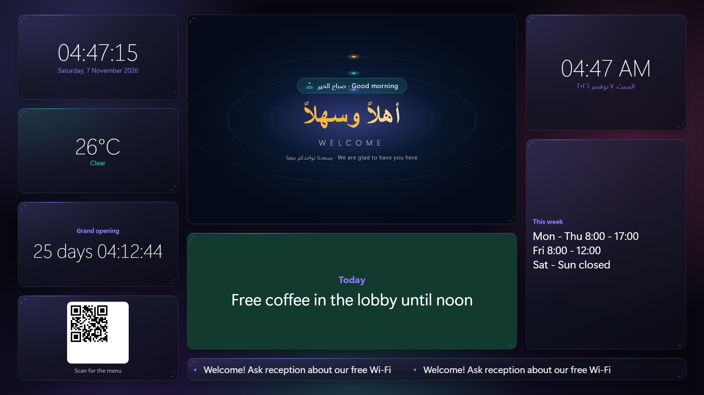

# LobbyBoard

**Free, self-hosted digital signage and front desk for small organisations.**
Put your own content on every TV in your lobby, let reception change it in a tap, and keep
a visitors book and an enquiries inbox in the same place. No subscription, no per-screen
licence, no account with anyone. It runs on one computer in your office.



## What it does

**On the TVs**
- A **drag-and-drop designer** for each TV: place widgets on a 24 × 12 grid, resize them, and
  click one to set its text, colours, box look, file or speed. Use one design on every TV, or a
  different one per TV.
- **18 widgets**: text, picture, video loop, photo slideshow, digital clock, analogue clock,
  countdown, QR code, scrolling announcements, weather, web page, prayer times, Arabic headlines
  wheel, video/slideshow controlled by reception, About us slides, flag/picture, logo, contact
  card. See [docs/WIDGETS.md](docs/WIDGETS.md).
- A **background photo or video** per TV, with a darkness slider so text stays readable.
- **Announcements from reception**: "On a break", "Back in 15 minutes", "Closed", or their own
  text over the whole screen, with a movement, a colour or a picture/video behind it. It can switch
  itself off after a set time. Reception can save their own buttons.
- **Occasions**: holidays and celebrations take over with their own greeting, look and media,
  on dates you choose.
- The TV is just a web page. Any smart TV, TV stick or mini PC with a browser works.

**At the desk** (`/agent/`, one login, pages depend on the person's role)
- **TV control**: play videos, photos, playlists and music; announcements; upload files
  (an admin approves them first).
- **Visitors registry**: check people in and out, see who is in the building.
- **Enquiries**: emails and website-form messages land in one inbox, are sorted by topic and
  handed to an agent, who replies from the dashboard.
- **Logs** of every login, change and TV action, exportable as CSV.

## Quick start

You need [Docker](https://docs.docker.com/get-docker/).

```bash
git clone https://github.com/cloudit24/lobbyboard.git
cd lobbyboard
cp .env.example .env        # then edit .env: SECRET_KEY, ADMIN_PASSWORD, ALLOWED_HOSTS, PORT
docker compose up -d --build
```

1. Open `http://<this-computer's-ip>:<PORT>/admin/` and log in with `ADMIN_USERNAME` /
   `ADMIN_PASSWORD` from `.env`. Change the password afterwards.
2. Admin → **Display settings**: your organisation's name, logo, city (for prayer times and
   weather), contact details.
3. Admin → **Screens** → *Reception* → **Design this TV**.
4. On the TV's browser open `http://<this-computer's-ip>:<PORT>/screen/reception/`.

Full setup, including sound on the TV, reaching it from outside and backups:
[docs/SETUP.md](docs/SETUP.md).

## Guides

| Guide | For |
|---|---|
| [docs/SETUP.md](docs/SETUP.md) | Installing, the TV browser, sound, Cloudflare Tunnel, backups, updates |
| [docs/WIDGETS.md](docs/WIDGETS.md) | Every widget and its settings, backgrounds, one design for all TVs |
| [docs/RECEPTION.md](docs/RECEPTION.md) | Reception staff: playing media, announcements, own buttons |
| [docs/ADMIN-GUIDE.md](docs/ADMIN-GUIDE.md) | Admins: users and roles, uploads, playlists, mail, occasions |
| [docs/ADMIN-DESIGN.md](docs/ADMIN-DESIGN.md) | Developers: the admin look |
| [CHANGELOG.md](CHANGELOG.md) | What changed in each version |

## Privacy

- No organisation data, branding or keys ship with the code. Your settings live in the database
  (the `data` Docker volume) or in a private file you keep outside the repository.
- The TVs only talk to your server. Your server fetches weather from
  [Open-Meteo](https://open-meteo.com/), prayer times from
  [AlAdhan](https://aladhan.com/prayer-times-api) and the RSS feeds you add. None of these need
  an account or key.
- No camera, no face recognition, no tracking of viewers.

## Development

```bash
python -m venv .venv && .venv/Scripts/pip install -r requirements.txt   # Windows; use .venv/bin on Linux/macOS
DEBUG=1 python manage.py migrate
DEBUG=1 python manage.py createsuperuser
DEBUG=1 python manage.py runserver
DEBUG=1 python manage.py test
```

Stack: Django 5.2, SQLite (WAL), Gunicorn + WhiteNoise, nginx for media, GridStack (layout
designer, MIT), imap-tools (mailbox), openpyxl (Excel reports), segno (QR codes), optional
cloudflared. See [CONTRIBUTING.md](CONTRIBUTING.md) to help, and [SECURITY.md](SECURITY.md) to
report a security problem.

## Licence

MIT. See [LICENSE](LICENSE). The bundled Cairo font is under the SIL Open Font License, and
GridStack under MIT (licence next to the file in `static/vendor/`).
